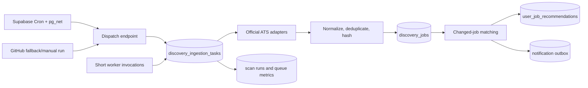

# Backend ingestion engine

## Decision

Build a durable ingestion queue in Supabase/Postgres and use Supabase Cron as the
durable clock. Supabase calls the existing private Vercel routes on the same
AppliHero deployment; GitHub Actions remains a three-hour fallback and manual
recovery runner. This reuses the working provider adapters, source locks,
normalized jobs, and Vercel deployment without adding another backend service.

This supersedes the original Milestone 1 assumption that GitHub Actions could
provide the primary hourly trigger. Production observation showed scheduled
workflows could be delayed for more than an hour, so the database that owns the
queue now also owns the schedule and invocation ledger.

Do **not** introduce a separate queue vendor, OpenSearch, or a browser crawler in this milestone. Those can be evaluated after the system has reliable source-level metrics and a meaningful operating load.

## Why this is the right next step

The current hourly four-shard scan is a useful bridge, but each request still owns a whole set of providers until it finishes. That makes it harder to:

- retry one failed company without rescanning its shard;
- see exactly what is waiting, running, or repeatedly failing;
- prevent a slow source from consuming the full serverless deadline;
- finish a partial hour after a GitHub Actions or deployment interruption;
- grow beyond the current catalog without increasingly large shards.

A database-backed queue gives each company scan an idempotent work item. Multiple small workers claim items safely, and a failed item can retry without affecting the rest of the catalog.

## Target architecture

### Work item lifecycle

`queued → running → succeeded`

Recoverable failures move to `retry_wait` with exponential backoff. Permanent configuration or adapter failures move to `failed` after the retry budget. A worker lease expires automatically so a serverless timeout cannot leave an item stuck in `running`.

### Idempotency

- One task is created per `source_id` and hourly `scheduled_for` bucket.
- A unique constraint prevents duplicate dispatcher calls from creating duplicate scans.
- Existing source-level scan locks remain a second safety boundary.
- Job writes continue to use `(source_id, source_job_id)` upserts and hashes.
- Matching runs only for new, changed, or incomplete jobs; rerunning a task cannot generate duplicate alerts.

## Milestone 1: durable hourly ingestion

This is feasible in a short implementation cycle because it changes orchestration, not provider parsing.

### 1. Queue schema and atomic claiming

Create an additive migration containing:

- `discovery_ingestion_tasks`: source, scheduled bucket, status, attempts, priority, lease token/until, timestamps, error summary, and a compact result summary.
- a unique constraint on `(source_id, scheduled_for)`;
- indexes for ready work and expired leases;
- an RPC using `FOR UPDATE SKIP LOCKED` to atomically claim a small batch;
- an RPC or guarded update to finish/retry only tasks held by the worker's lease token.

Acceptance criteria:

- two workers cannot claim the same task;
- rerunning the dispatcher for an hour does not add duplicate tasks;
- an expired lease is claimable again.

### 2. Dispatcher endpoint

Add a cron-protected dispatch route that:

- identifies every enabled source due for the current hourly bucket;
- inserts tasks in idempotent chunks;
- requeues expired running tasks;
- returns counts only, never a large per-source payload.

Supabase Cron invokes the dispatcher every five minutes. GitHub Actions retains
a small dispatcher plus worker matrix for fallback/manual recovery. The
dispatcher remains safe to run more than once because its work is bucketed and
idempotent.

Acceptance criteria:

- all enabled companies receive one hourly task whether or not any user follows them;
- a second invocation returns zero newly-created tasks for the same bucket;
- the response completes quickly, independent of provider latency.

### 3. Worker endpoint and bounded processing

Add a cron-protected worker route that:

- claims one to three tasks per invocation;
- runs the existing `syncSource(..., { catalogOnly: true })` implementation;
- records source-level result telemetry and marks the task complete, retryable, or failed;
- stops before the Vercel duration limit, leaving remaining work queued.

Several staggered Supabase Cron invocations run workers in parallel. The
fallback GitHub workflow can add bounded capacity, but neither scheduler decides
which companies a worker scans; workers atomically claim the next available
task.

Acceptance criteria:

- one slow/failing source does not stop unrelated companies;
- a transient provider error retries with bounded backoff;
- no task is silently lost on worker timeout;
- catalog writes and notification deduplication remain unchanged.

### 4. Finalizer, digests, and alert correctness

Run enrichment and email digest finalization as a separate idempotent maintenance route. It should run after the worker pool starts and can also run in the next hourly trigger if work is still in progress.

Acceptance criteria:

- no duplicate digest is sent when more than one worker finishes around the same time;
- new-match notifications occur only after the corresponding job/recommendation writes are durable;
- a failed email remains visible and retryable.

### 5. Operations visibility

Add an internal-only endpoint or lightweight panel showing:

- queued/running/retry/failed task counts;
- oldest queued task age;
- source success rate and last successful scan;
- recent adapter errors grouped by provider;
- catalog freshness: the oldest successful scan among enabled sources.

This is intentionally operational rather than a user-facing dashboard. The existing Discover page continues to show the oldest followed-company freshness timestamp.

Acceptance criteria:

- an operator can determine whether the hourly run is caught up without reading logs;
- an individual failed source can be retried safely.

## Milestone 2: quality and scale hardening

Only start after Milestone 1 is running reliably for at least a few days.

1. Provider-specific concurrency and request budgets, starting with Workday/Eightfold.
2. Raw response snapshots in object storage for parser debugging, with retention limits.
3. Authoritative full-board closure reconciliation; never close a role from an incremental frontier alone.
4. Profile-change matching tasks so all saved recommendations refresh asynchronously when a résumé or preferences change.
5. Automated provider health checks and fixture regression tests for failed source families.

## Explicit non-goals

- No generic crawling of 100,000 company sites in this milestone.
- No source-specific patching in the queue layer; provider adapters remain the extension point.
- No semantic search platform migration before Postgres indexing and observed query metrics justify it.
- No user-facing claim that a company was checked “now” until its source task has actually completed.

## Delivery order and checkpoints

| Step | Deliverable | Checkpoint |
| --- | --- | --- |
| 1 | Migration and task-claim RPCs | Concurrent claim/idempotency tests pass |
| 2 | Dispatcher and GitHub workflow update | One hourly bucket enqueues all enabled sources |
| 3 | Worker route | A mixed provider batch completes and retries safely |
| 4 | Digest finalizer | No duplicate notification/email in repeated runs |
| 5 | Internal queue visibility | Queue age and failures are observable |
| 6 | Load test | 100-source run completes with no duplicate jobs/tasks |

## Go/no-go criteria

Proceed now if we keep the scope to Milestone 1. It is a contained orchestration change that makes the existing system more dependable without replacing working parsing logic.

Pause or introduce an external queue only if Supabase RPC claiming cannot be deployed safely, Vercel worker limits prove too restrictive after batching, or the hourly catalog grows far beyond what the worker pool can drain. In that case, Upstash QStash is the lowest-friction managed next option because it can invoke HTTP workers with retries and scheduled delivery.
